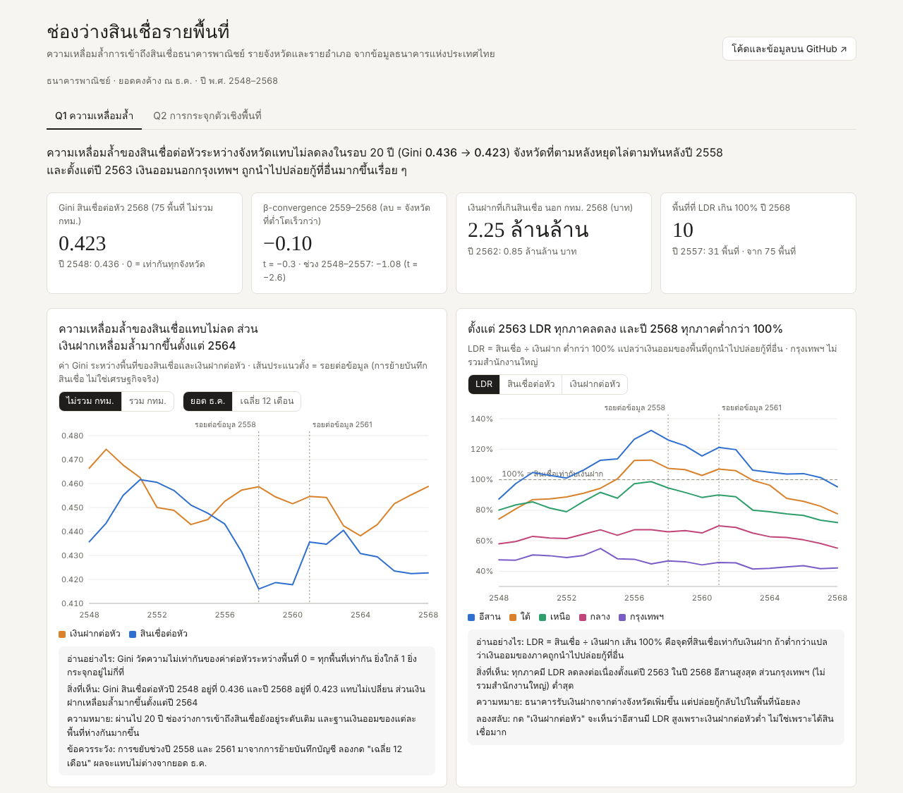
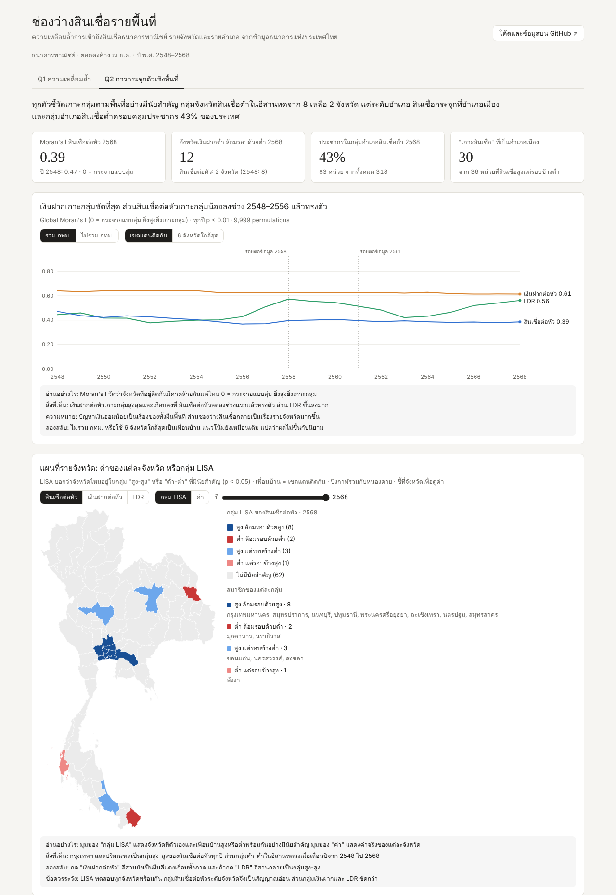
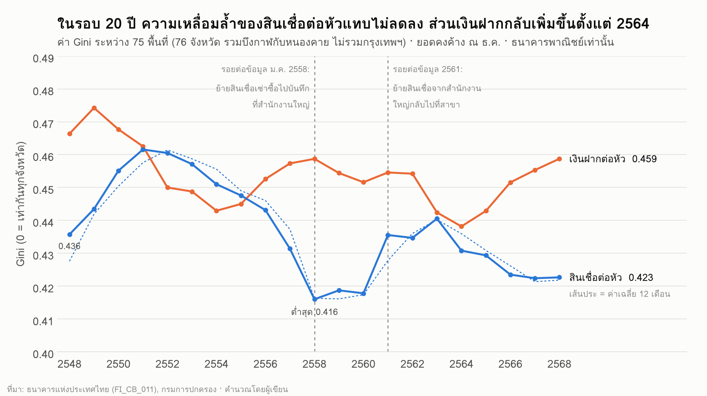
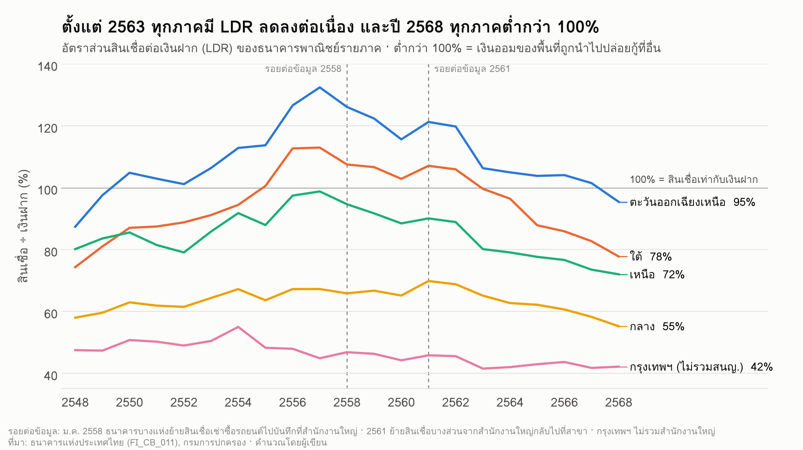
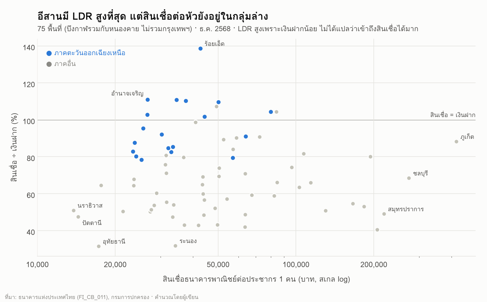
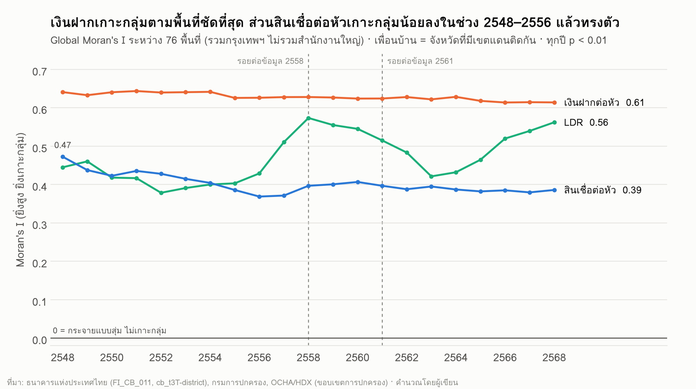
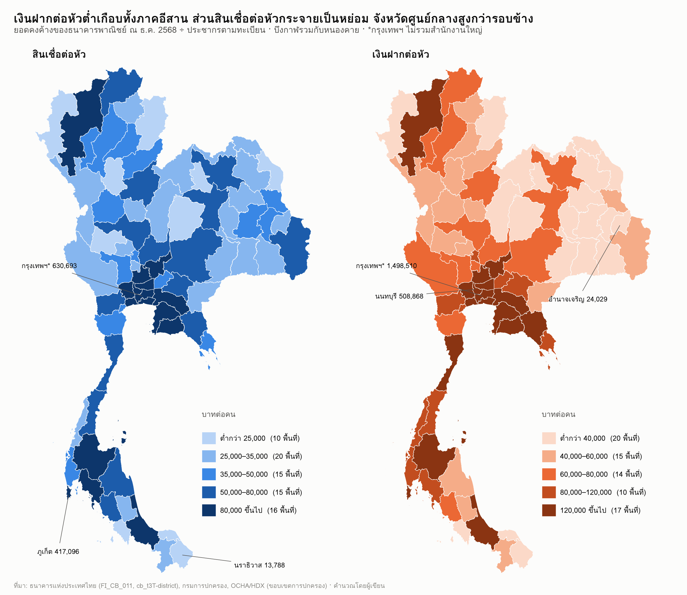
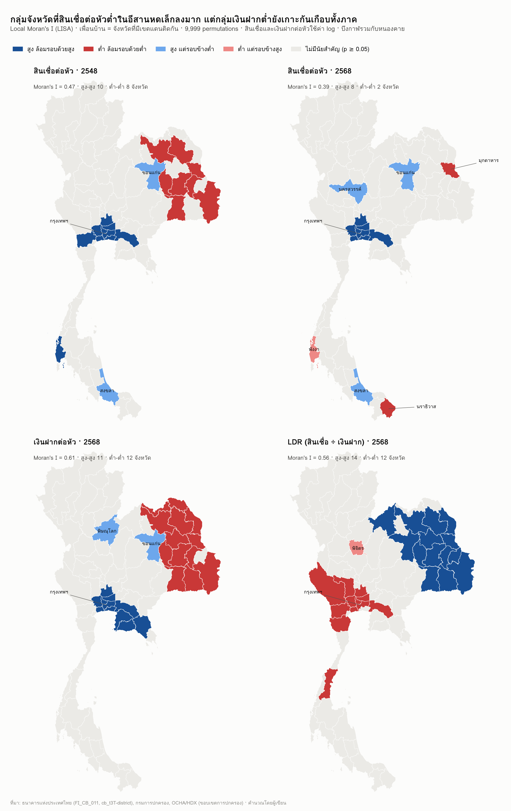
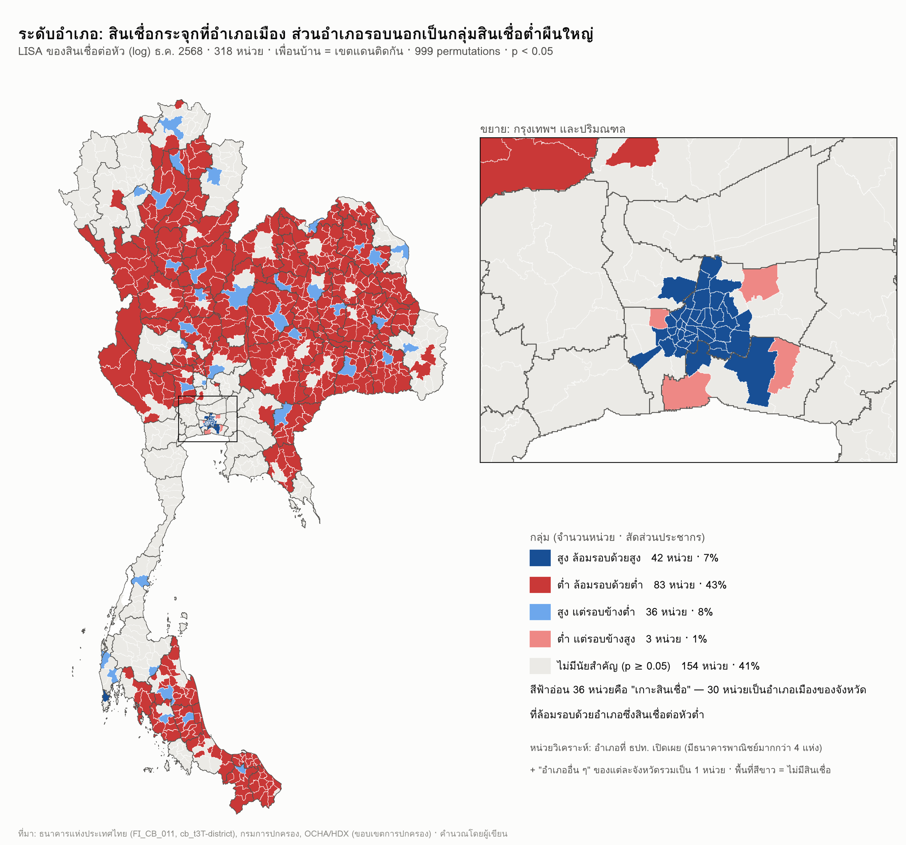

# ความเหลื่อมล้ำการเข้าถึงสินเชื่อธนาคารพาณิชย์รายพื้นที่

> **Regional Credit Access Gap in Thailand:** เงินออมของคนในแต่ละพื้นที่ถูกปล่อยกลับเป็นสินเชื่อในพื้นที่นั้นมากน้อยแค่ไหน และพื้นที่ไหนถูกดึงเงินออกอย่างต่อเนื่อง ใช้ข้อมูลสถิติรายจังหวัดและรายอำเภอของธนาคารแห่งประเทศไทย (ธปท.) ปี 2548–2568

**TL;DR (English):** Using 21 years of Bank of Thailand province- and district-level deposit and loan data, this project finds that the gap in commercial-bank credit per capita across Thai provinces has not narrowed in 20 years (Gini 0.436 → 0.423), lagging provinces stopped catching up after 2014, and since 2020 the deposits outside Bangkok that are not lent back locally have grown from 0.85 to 2.25 trillion baht. The largest gap is within provinces — between the provincial capital district and its surrounding districts — rather than between regions.

### [เปิด Interactive Dashboard](https://sangsanfr.github.io/thailand-credit-access-gap/dashboard/)

รวมกราฟและแผนที่ของ Q1 และ Q2 ไว้ในหน้าเดียว เลือกปี ตัวชี้วัด และขอบเขตได้ ชี้ที่เส้น จุด หรือจังหวัดเพื่อดูค่า และค้นหาหรือเรียงตารางรายจังหวัดได้ (ถ้าลิงก์ยังไม่ขึ้น ดาวน์โหลด repo แล้วดับเบิลคลิก `dashboard/index.html` ได้เลย)

| Q1 ความเหลื่อมล้ำ | Q2 การกระจุกตัวเชิงพื้นที่ |
|---|---|
| [](https://sangsanfr.github.io/thailand-credit-access-gap/dashboard/) | [](https://sangsanfr.github.io/thailand-credit-access-gap/dashboard/#q2) |

---

## สรุปผลการวิเคราะห์

### ภาพรวมใน 3 ประโยค

1. **ช่องว่างการเข้าถึงสินเชื่อระหว่างจังหวัดไม่แคบลงในรอบ 20 ปี** และจังหวัดที่ตามหลังหยุดไล่ตามทันตั้งแต่ราวปี 2557
2. **ตั้งแต่ปี 2563 เงินออมนอกกรุงเทพฯ ถูกนำไปปล่อยกู้ที่อื่นมากขึ้น** คนต่างจังหวัดฝากเงินเพิ่มขึ้น แต่ได้สินเชื่อกลับน้อยลง
3. **ช่องว่างที่ใหญ่ที่สุดอยู่ระหว่างอำเภอเมืองกับอำเภอรอบนอกในจังหวัดเดียวกัน** ไม่ใช่ระหว่างภาค ส่วนอีสานเป็นปัญหา "เงินออมน้อย" มากกว่า "ถูกดึงเงินออก"

### ตัวเลขสำคัญ

| ตัวชี้วัด | ค่า | ความหมาย |
|---|---|---|
| Gini สินเชื่อต่อหัว (75 พื้นที่ ไม่รวมกรุงเทพฯ) | 0.436 (2548) → 0.423 (2568) | ความเหลื่อมล้ำแทบไม่เปลี่ยน |
| β-convergence ช่วง 2548–2557 | β = −1.08, t = −2.6 | จังหวัดที่เริ่มต่ำโตเร็วกว่า (ไล่ตามทัน) |
| β-convergence ช่วง 2559–2568 | β = −0.10, t = −0.4 | ไม่ไล่ตามแล้ว และสินเชื่อต่อหัวโตเฉลี่ยแค่ 0.6% ต่อปี |
| Gini เงินฝากต่อหัว | 0.438 (2564) → 0.459 (2568) | ฐานเงินออมห่างกันมากขึ้น |
| สัดส่วนความเหลื่อมล้ำที่อยู่ "ระหว่างภาค" (Theil) | ราว 34% | อีก 2 ใน 3 อยู่ภายในภาคเดียวกัน |
| เงินฝากส่วนที่เกินสินเชื่อ นอกกรุงเทพฯ | 0.85 (2562) → 2.25 ล้านล้านบาท (2568) | เงินออมไหลออกไปปล่อยกู้ที่อื่นมากขึ้น |
| LDR รายภาค ปี 2568 | ทุกภาคต่ำกว่า 100% (อีสานสูงสุด 95%) | ไม่มีภาคไหนได้สินเชื่อเท่ากับเงินที่ฝาก |
| Moran's I เงินฝากต่อหัว | 0.61–0.64 ทุกปี (p < 0.01) | พื้นที่เงินออมน้อยอยู่ติดกันเป็นกลุ่มชัดเจน |
| Moran's I สินเชื่อต่อหัว | 0.47 (2548) → 0.37 (2556) แล้วทรงตัว | การจับกลุ่มของสินเชื่อลดลงช่วงแรก |
| จังหวัดสินเชื่อต่ำที่รอบข้างก็ต่ำ (LISA) | 8 จังหวัดอีสาน (2548) → 2 จังหวัด (2568) | กลุ่มสินเชื่อต่ำในอีสานหดเล็กลง |
| จังหวัดเงินฝากต่ำที่รอบข้างก็ต่ำ (LISA) | 12 จังหวัดอีสาน ติดกันเป็นผืนเดียว (2568) | ปัญหาฐานเงินออมยังครอบคลุมเกือบทั้งภาค |
| อำเภอสินเชื่อสูงแต่รอบข้างต่ำ (LISA ปี 2568) | 36 หน่วย เป็นอำเภอเมือง 30 หน่วย | สินเชื่อกระจุกที่ตัวเมือง (hub-and-spoke) |
| ประชากรในพื้นที่ "ต่ำ-ต่ำ" ระดับอำเภอ | 43% ของประเทศ | คนจำนวนมากอยู่ในแถบที่สินเชื่อน้อยทั้งแถบ |

### ข้อค้นพบ Q1: ความเหลื่อมล้ำ ([รายละเอียด](reports/q1_findings.md))

1. **ความเหลื่อมล้ำของสินเชื่อต่อหัวแทบไม่เปลี่ยนในรอบ 20 ปี** Gini ระหว่าง 75 พื้นที่ (ไม่รวมกรุงเทพฯ) เป็น 0.436 ในปี 2548 และ 0.423 ในปี 2568
2. **จังหวัดที่สินเชื่อต่อหัวต่ำหยุดไล่ตามทัน** ช่วง 2548–2557 จังหวัดที่เริ่มต่ำโตเร็วกว่า แต่ช่วง 2559–2568 ไม่ไล่ตามแล้ว
3. **เงินฝากเหลื่อมล้ำมากขึ้น** ตั้งแต่ปี 2564
4. **ความเหลื่อมล้ำประมาณ 2 ใน 3 อยู่ภายในภาค** ไม่ใช่ระหว่างภาค
5. **ตั้งแต่ 2563 เงินออมนอกกรุงเทพฯ ไหลออกมากขึ้น** และปี 2568 ทุกภาคมี LDR ต่ำกว่า 100%
6. **อีสานมี LDR สูงสุด แต่สินเชื่อต่อหัวอยู่กลุ่มล่าง** เพราะเงินฝากในพื้นที่น้อย LDR สูงจึงไม่ได้แปลว่าเข้าถึงสินเชื่อได้ดี

| | |
|---|---|
|  |  |
|  | |

### ข้อค้นพบ Q2: การกระจุกตัวเชิงพื้นที่ ([รายละเอียด](reports/q2_findings.md))

1. **ทุกตัวชี้วัดเกาะกลุ่มตามพื้นที่อย่างมีนัยสำคัญทุกปี** (Moran's I, p < 0.01) เงินฝากต่อหัวเกาะกลุ่มชัดที่สุด
2. **กลุ่มสินเชื่อต่ำในอีสานหดเล็กลง แต่กลุ่มเงินฝากต่ำยังเกาะกันเกือบทั้งภาค**
   - จังหวัดที่สินเชื่อต่ำและรอบข้างก็ต่ำ ลดจาก 8 จังหวัดอีสาน (2548) เหลือ 2 จังหวัดในปี 2568 คือมุกดาหาร (อีสาน) และนราธิวาส (ภาคใต้)
   - กลุ่มเงินฝากต่ำยังติดกันเป็นผืนเดียว 12 จังหวัด
   - พื้นที่ที่เงินออมไหลออกมากที่สุด (LDR ต่ำ-ต่ำ) คือกรุงเทพฯ และปริมณฑล ภาคกลางตอนล่าง ภาคตะวันตก และชุมพร
3. **ระดับอำเภอ สินเชื่อกระจุกที่อำเภอเมือง (hub-and-spoke)**
   - 30 จาก 36 หน่วยที่สินเชื่อสูงแต่รอบข้างต่ำเป็นอำเภอเมือง สินเชื่อต่อหัวราว 5 เท่าของอำเภอรอบข้าง
   - กลุ่มที่สินเชื่อต่ำและรอบข้างก็ต่ำครอบคลุมประชากร 43% ของประเทศ

| | |
|---|---|
|  |  |
|  |  |

---

## สารบัญ

1. [คำถามและตัวชี้วัด](#1-คำถามและตัวชี้วัด)
2. [ข้อมูลที่ใช้](#2-ข้อมูลที่ใช้)
3. [การเตรียมข้อมูลและการตัดสินใจสำคัญ](#3-การเตรียมข้อมูลและการตัดสินใจสำคัญ)
4. [วิธีวิเคราะห์](#4-วิธีวิเคราะห์)
5. [การตรวจความถูกต้อง](#5-การตรวจความถูกต้อง)
6. [ข้อจำกัด](#6-ข้อจำกัด)
7. [โครงสร้างไฟล์และวิธีรันซ้ำ](#7-โครงสร้างไฟล์และวิธีรันซ้ำ)

---

## 1. คำถามและตัวชี้วัด

**คำถามหลัก:** เงินออมของคนในพื้นที่ถูกปล่อยเป็นสินเชื่อกลับไปในพื้นที่นั้นมากน้อยแค่ไหน และพื้นที่ไหนถูกดึงเงินออก

| # | คำถามย่อย |
|---|---|
| Q1 | ความเหลื่อมล้ำของสินเชื่อต่อหัวและ LDR สูงแค่ไหน และกว้างขึ้นหรือแคบลงตามเวลา |
| Q2 | พื้นที่ที่เข้าถึงสินเชื่อต่ำเกาะกลุ่มกันทางภูมิศาสตร์หรือไม่ |

**ตัวชี้วัด**

- **LDR** = สินเชื่อ ÷ เงินฝาก × 100 ถ้าต่ำกว่า 100% แปลว่าเงินออมของพื้นที่ถูกนำไปปล่อยกู้ที่อื่น
- **สินเชื่อต่อหัว และเงินฝากต่อหัว** = ยอดคงค้าง ÷ ประชากรตามทะเบียน
- ต้องดู LDR คู่กับค่าต่อหัวเสมอ เพราะ LDR สูงอาจเกิดจากเงินฝากน้อย ไม่ได้แปลว่าเข้าถึงสินเชื่อได้มาก

**ขอบเขต**

- ธนาคารพาณิชย์เท่านั้น (ไม่รวม ธ.ก.ส. ออมสิน สหกรณ์ non-bank)
- ระดับจังหวัด 76 หน่วย คือกรุงเทพฯ (ไม่รวมสำนักงานใหญ่) กับ 75 พื้นที่ โดยรวมบึงกาฬกับหนองคายเป็นพื้นที่เดียว
- ระดับอำเภอเฉพาะอำเภอที่ ธปท. เปิดเผย ส่วนที่ถูกซ่อนรวมเป็นหน่วย "อำเภออื่น ๆ" ของแต่ละจังหวัด
- ช่วงปี 2548–2568 ใช้ยอด ธ.ค. เป็นค่ารายปี

---

## 2. ข้อมูลที่ใช้

| ID | ชุดข้อมูล | แหล่ง | ระดับ / ช่วงเวลา | ไฟล์ใน repo | ใช้ทำ |
|---|---|---|---|---|---|
| D1 | เงินฝากและสินเชื่อ ธพ. รายอำเภอ `FI_CB_095_S2` | ธปท. | อำเภอ · ส.ค. 2569 | `data/raw/D1/*.txt` (เก็บจากหน้าเว็บ) | ต้นแบบ format และรายชื่ออำเภอที่ถูกซ่อน |
| D2 | เงินฝากและสินเชื่อ ธพ. รายอำเภอ ย้อนหลัง (`cb_t3T-district.zip`) | ธปท. | อำเภอ · ม.ค. 2548 – ก.ค. 2569 รายเดือน | `data/raw/D2/*.xls(x)` 23 ไฟล์ | ระดับอำเภอ |
| D3 | เงินรับฝากและสินเชื่อ ธพ. รายจังหวัด `FI_CB_011_S1–S5` | ธปท. | จังหวัด · รายเดือน | `data/raw/D3/*.XLSX` | ระดับจังหวัด |
| D4 | สินเชื่อตามประเภทธุรกิจ (ISIC Rev.4) รายจังหวัด `FI_CB_087_S2–S3` | ธปท. | จังหวัด · 2556– | `data/raw/D4/*.XLSX` | สัดส่วนสินเชื่อรายภาคธุรกิจใน panel (ยังไม่ได้ใช้ในการวิเคราะห์) |
| D6 | ประชากรตามทะเบียนรายอำเภอ | กรมการปกครอง | อำเภอ · 31 ธ.ค. 2548–2568 | `data/raw/D6/dopa_population_amphoe_2548-2568.csv` | ตัวหารต่อหัว |
| D7 | ขอบเขตการปกครอง (COD-AB) | OCHA/HDX (ขอบเขตปี 2565) | จังหวัด/อำเภอ | `data/raw/D7/tha_admin_boundaries.xlsx` + shapefile ([ต้องดาวน์โหลดเอง](data/raw/D7/README.md)) | แผนที่, เพื่อนบ้าน, ตาราง lookup รหัส |

**สิ่งที่พบเมื่อเปิดไฟล์จริง**

- **D1**: ไฟล์ export `FI_CB_095_S2_TH_ALL.XLSX` เสีย มีข้อมูล ม.ค.–ก.พ. 2548 แต่ติดหัวคอลัมน์ผิด ข้อมูล D1 ที่ใช้ได้มีแค่เดือน ส.ค. 2569 ซึ่งเก็บมาจากหน้าเว็บ ตัวเลขรายเดือนจึงมาจาก D2 ทั้งหมด
- **D2**: แต่ละปีมีหัวคอลัมน์ไม่เหมือนกัน (ปี 2548 ไม่มีตั๋วสัญญาใช้เงินและบัตรเงินฝาก) parser จึง map ชื่อหัวคอลัมน์เข้ากับคอลัมน์มาตรฐานแบบ D1 ไฟล์มีแถว **"สำนักงานใหญ่"** แยกต่างหาก ถือสินเชื่อราว 53% และเงินฝากราว 19% ของทั้งระบบ
- **D3**: ไฟล์ `FI_CB_011_S6` ฉบับ ALL เปิดไม่ได้ จึงใช้ S1–S5 ต่อกัน ถ้าเดือนเดียวกันมีหลาย series ใช้ series ใหม่กว่า กรุงเทพฯ ใน D3 = แถวสำนักงานใหญ่ + แถว "อื่น ๆ"
- **D6**: ระบบสถิติทางทะเบียนรับคำขอเฉพาะจากหน้าเว็บ จึงดึงผ่านเบราว์เซอร์ ข้อมูลมาเป็นรายสำนักทะเบียน (รวมเทศบาลและสาขาตำบล) แล้ว map เข้าอำเภอ ผลรวมตรงกับยอดทั้งประเทศครบ 21 ปี

ลิงก์ดาวน์โหลดตาราง ธปท. ใช้รูปแบบ `https://app.bot.or.th/BTWS_STAT/statistics/DownloadFile.aspx?file=<CODE>_TH_ALL.XLSX` และดูรายการตารางได้ที่ [สถิติสถาบันการเงิน](https://www.bot.or.th/th/statistics/financial-institutions.html)

---

## 3. การเตรียมข้อมูลและการตัดสินใจสำคัญ

| เรื่อง | การตัดสินใจ | เหตุผล |
|---|---|---|
| ค่ารายปี | ใช้ยอดคงค้าง ณ ธ.ค. (`*_dec`) และใช้ค่าเฉลี่ย 12 เดือน (`*_avg12`) เป็นตัวตรวจ | เงินฝากและสินเชื่อเป็นยอดคงค้าง (stock) ห้ามรวม 12 เดือน ผลทั้ง 2 วิธีต่างกันไม่เกิน 0.008 Gini |
| สำนักงานใหญ่ | แยกเป็นหน่วย `HQ` ไม่นับเป็นของพื้นที่ใด กรุงเทพฯ จึงไม่รวมสำนักงานใหญ่ | สินเชื่อบริษัทใหญ่และเช่าซื้อรถยนต์บันทึกที่สำนักงานใหญ่ ไม่ได้สะท้อนพื้นที่จริง |
| บึงกาฬ | รวมกับหนองคาย (`prov_code_h` 38 → 43) ทุกปี | บึงกาฬแยกจังหวัดในปี 2554 แต่ D3 เริ่มแสดงแยกปี 2556 รวมกันจึงได้หน่วยพื้นที่เดียวกันทุกปี รหัสอำเภอเก่า 43xx ใช้ตาราง `crosswalk_buengkan_codes.csv` แปลง |
| อำเภอที่ถูกซ่อน | สร้างหน่วย **"อำเภออื่น ๆ"** (`{prov}_REST`) = ยอดจังหวัด − ผลรวมอำเภอที่เปิดเผย และประชากรคิดแบบเดียวกัน | ธปท. ซ่อนอำเภอที่มีธนาคารไม่เกิน 4 แห่ง ถ้าตัดทิ้งจะไม่เห็นพื้นที่ชนบทที่สนใจที่สุด |
| ช่วงทับซ้อน 2567–2568 | ใช้ข้อมูลฐานสินเชื่อใหม่ (S2) | 12 เดือนที่ทับกัน เงินฝากตรงกันทุกค่า สินเชื่อต่างกันแค่ค่ากลาง 0.31% |
| เครื่องหมายในตาราง ธปท. | `-` = 0, `n.a.` = ถูกซ่อน (NULL), ช่องว่าง = ไม่มีข้อมูล | ตามคำอธิบายของ ธปท. |
| ข้อมูลขาด | เงินฝากพระนคร มี.ค. 2563 ไม่มียอดรวม จึงรวมจากรายการย่อย · ฉะเชิงเทรา พ.ค. 2562 ว่างทั้งแถว เก็บเป็น `data_gap = 1` | พบตอนตรวจความถูกต้อง |

**รอยต่อข้อมูล (series break) ที่ต้องระวังเมื่อดูแนวโน้ม**

- **ม.ค. 2558** ธนาคารบางแห่งย้ายสินเชื่อเช่าซื้อรถยนต์ไปบันทึกที่สำนักงานใหญ่ ตามหมายเหตุท้ายตาราง ธปท.
- **2561** สินเชื่อของสำนักงานใหญ่ลดลง 0.22 ล้านล้านบาท ขณะที่กรุงเทพฯ และปริมณฑลเพิ่มขึ้น น่าจะเป็นการย้ายบันทึกกลับไปที่สาขา
- การคำนวณ β-convergence จึงเลือกช่วงปีที่ไม่คร่อมปี 2558 และทุกกราฟแนวโน้มมีเส้นบอกรอยต่อทั้ง 2 จุด

---

## 4. วิธีวิเคราะห์

| คำถาม | วิธี | หน่วย |
|---|---|---|
| Q1 | Gini (ไม่ถ่วงและถ่วงประชากร), Theil T แยกส่วนระหว่างภาคและภายในภาค, CV, sd(log), P90/P10, β-convergence (OLS) | 76 หน่วย / 75 ไม่รวมกรุงเทพฯ |
| Q2 | Global Moran's I และ LISA (permutation 9,999 ครั้ง, ทดสอบ FDR เพิ่ม), เพื่อนบ้านแบบ Queen contiguity และ kNN-6 เป็นตัวตรวจ | จังหวัด 76 หน่วย · อำเภอ 318 หน่วย (ปี 2568) |

เพื่อนบ้านสร้างจากจุดยอดที่ใช้ร่วมกันของขอบเขตอำเภอ เพราะข้อมูล OCHA มี topology ตรงกันพอดี พื้นที่ที่เป็นเกาะให้ใช้พื้นที่ใกล้สุดเป็นเพื่อนบ้าน การอ่าน shapefile, การหาเพื่อนบ้าน และ Moran's I/LISA เขียนเองด้วย numpy, scipy และ pyshp โดยไม่ใช้ geopandas หรือ PySAL (`src/geo_utils.py`, `src/q2_spatial.py`)

---

## 5. การตรวจความถูกต้อง

| การตรวจ | ผล |
|---|---|
| ผลรวมทุกจังหวัด (รวมสำนักงานใหญ่) = ยอดทั้งประเทศใน D3 | ต่างกันไม่เกิน 6 ล้านบาท (ปัดเศษ) |
| กรุงเทพฯ ใน D3 = สำนักงานใหญ่ + "อื่น ๆ" | ตรงกันทุกเดือน |
| ผลรวมอำเภอ + "อำเภออื่น ๆ" = ยอดจังหวัด | 21 ปี มีจังหวัด-ปีที่ต่างเกิน 0.1% แค่ 2 กรณี (สมุทรปราการ 2548, สมุทรสาคร 2550) |
| ประชากรรวม = ยอดทั้งประเทศของกรมการปกครอง | ต่างกัน 0 คนทุกปี |
| หน่วย "อำเภออื่น ๆ" ที่ติดลบ | 1 กรณี (สมุทรปราการ 2548) ตั้งเป็นค่าว่างและติด flag |
| ความไวต่อวิธีเลือกค่ารายปี (ธ.ค. vs เฉลี่ย 12 เดือน) | Gini ต่างกันไม่เกิน 0.008 · Moran's I ต่างกันไม่เกิน 0.03 |
| ความไวต่อนิยามเพื่อนบ้าน (Queen vs kNN-6) | แนวโน้มเดียวกันทุกตัวแปร |

---

## 6. ข้อจำกัด

1. **เฉพาะธนาคารพาณิชย์** ธ.ก.ส. และออมสินเป็นแหล่งสินเชื่อหลักในชนบท ข้อสรุปจึงเป็นเรื่อง "การเข้าถึงสินเชื่อธนาคารพาณิชย์" เท่านั้น
2. **สินเชื่อบันทึกตามที่ตั้งสาขา** ไม่ใช่ที่อยู่ของผู้กู้ รูปแบบ hub-and-spoke ส่วนหนึ่งจึงสะท้อนที่ตั้งสาขา
3. **อำเภอที่ถูกซ่อน** ทำให้หน่วยระดับอำเภอมีขนาดไม่เท่ากัน (MAUP) จึงตรวจซ้ำด้วยอำเภอที่เปิดเผยอย่างเดียว ได้ Moran's I = 0.47
4. **LISA ทดสอบหลายพื้นที่พร้อมกัน** กลุ่มสินเชื่อระดับจังหวัดผ่านเกณฑ์ FDR แค่ 4 จังหวัดในปี 2568 ควรอ่านเป็นสัญญาณอ่อน
5. **ประชากรตามทะเบียนบ้าน** ไม่สะท้อนแรงงานย้ายถิ่น ค่าต่อหัวของจังหวัดอุตสาหกรรมจึงอาจสูงเกินจริง
6. **รอยต่อข้อมูล 2558 และ 2561** เป็นผลทางบัญชี ไม่ใช่เศรษฐกิจจริง
7. **ขอบเขตการปกครองปี 2565** ใช้กับทุกปี

---

## 7. โครงสร้างไฟล์และวิธีรันซ้ำ

```
thailand-credit-access-gap/
├── README.md
├── requirements.txt
├── run_all.sh                ← รันทุกขั้นตามลำดับ
├── data/raw/                 ← ข้อมูลดิบ (ไม่แก้ไข)
│   ├── D1/  D2/  D3/  D4/  D6/
│   └── D7/                   ตาราง lookup (shapefile ต้องดาวน์โหลดเอง ดู D7/README.md)
├── processed/
│   ├── district_monthly_D2.csv          รายอำเภอ × รายเดือน 2548–2569 (240,539 แถว)
│   ├── column_dictionary.csv, district_monthly_sources.csv, d2_overlap_old_vs_S2.csv
│   ├── panels/               province_panel(_harmonised), district_panel, dim_*, crosswalk, _validation
│   └── geo/                  เพื่อนบ้าน, หน่วยวิเคราะห์รายปี, geojson แบบย่อ
├── outputs/
│   ├── q1/  (csv + fig/)     Gini, Theil, convergence, LDR รายภาค
│   └── q2/  (csv + fig/)     Moran's I, LISA จังหวัด/อำเภอ, แผนที่
├── dashboard/                interactive dashboard (เปิด index.html ได้เลย ไม่ต้องติดตั้งอะไร)
├── reports/                  q1_findings.md, q2_findings.md
└── src/                      สคริปต์ทั้งหมด
```

ผลลัพธ์ทุกไฟล์ใน `processed/` และ `outputs/` อยู่ใน repo แล้ว ดูผลได้โดยไม่ต้องรันใหม่

**ถ้าต้องการรันซ้ำตั้งแต่ข้อมูลดิบ**

- Python 3 และแพ็กเกจใน `requirements.txt` (`pip install -r requirements.txt`)
- LibreOffice สำหรับแปลงไฟล์ D2 `.xls` เก่าเป็น `.xlsx` (ขั้นที่ 0)
- shapefile ของ OCHA ใน `data/raw/D7/shp/` สำหรับขั้นที่ 4–5
- ฟอนต์ไทย Loma สำหรับกราฟ (Linux: แพ็กเกจ `fonts-tlwg-loma`) ถ้าไม่มี กราฟจะใช้ DejaVu Sans ซึ่งไม่มีอักษรไทย

```bash
bash run_all.sh
```

| ขั้น | สคริปต์ | ผลลัพธ์ |
|---|---|---|
| 0 | `soffice` | แปลง D2 `.xls` → `d2_xlsx/` |
| 1 | `build_district.py`, `clean_d2.py` | `processed/district_monthly_D2.csv` |
| 2 | `build_panels.py` | `processed/panels/` |
| 3 | `q1_inequality.py`, `q1_charts.py` | `outputs/q1/` |
| 4 | `q2_spatial.py`, `q2_maps.py` | `outputs/q2/`, `processed/geo/` (รอบแรกราว 3–4 นาที) |
| 5 | `dash_data.py` | `dashboard/data/data.js` |

`src/parse_bot.py` คือ parser กลางสำหรับไฟล์ ธปท. แปลงเดือนแบบไทย เช่น `ม.ค.48` และ `Q1/2556` และจัดการ `-` / `n.a.`

---

## แหล่งอ้างอิง

- [ธปท. — สถิติสถาบันการเงิน](https://www.bot.or.th/th/statistics/financial-institutions.html)
- [ธปท. — FI_CB_095_S2 เงินฝากและเงินให้สินเชื่อของธนาคารพาณิชย์รายอำเภอ](https://app.bot.or.th/BTWS_STAT/statistics/BOTWEBSTAT.aspx?reportID=1037&language=TH)
- [ธปท. — FI_CB_087_S3 สินเชื่อตามประเภทธุรกิจ (ISIC Rev.4) รายจังหวัด](https://app.bot.or.th/BTWS_STAT/statistics/BOTWEBSTAT.aspx?reportID=1020&language=TH)
- [กรมการปกครอง — ระบบสถิติทางการทะเบียน](https://stat.bora.dopa.go.th/stat/statnew/statyear/)
- [OCHA/HDX — Thailand Subnational Administrative Boundaries](https://data.humdata.org/m/dataset/cod-ab-tha)
